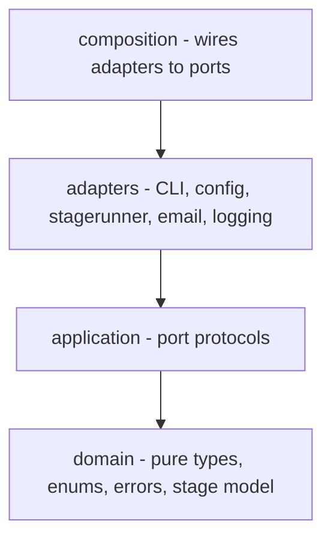
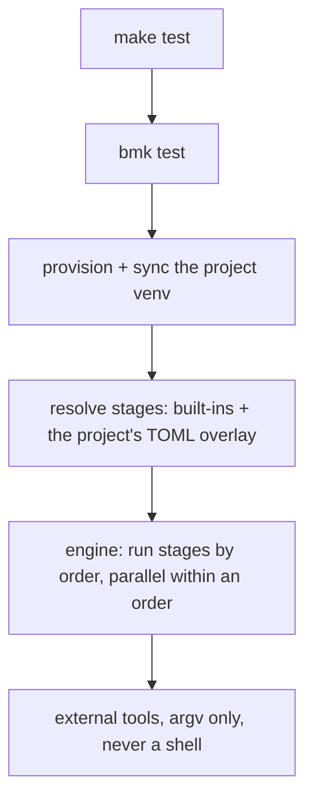

# System Documentation: bmk

> The first part is architecture level: WHY, and how the parts fit; the code owns the HOW.
> The Module Reference part lists the modules bmk shares with its CLI template
> (configuration, email, logging, the generic commands) as they are in the source tree.

## Status

Complete. The Module Reference describes the modules as they are in the source tree.
Update it with every change that adds, moves or removes a module, a CLI option or a public name.

## Purpose (Why)

A Python project needs the same dozen chores in every repo: format, lint, type-check, audit,
test, bump, tag, release. `make` is the right front door for them - it is everywhere, and it
gives a newcomer one thing to type. What rots is the inside: a make recipe is a string handed
to a shell, so the chores end up as hundreds of lines of bash, per repo, drifting apart, and
breaking differently on Windows.

bmk keeps the front door and replaces what is behind it. The Makefile becomes a thin,
versioned wrapper that delegates to a Python runner, so the same `make test` behaves
identically on Linux, macOS and Windows, and no repo has a shell script to maintain.

## Context

bmk drives a project it does not belong to. It reads that project's `pyproject.toml`,
provisions the project's virtualenv with uv, and runs external tools (ruff, pyright, bandit,
pip-audit, import-linter, pytest, shellcheck, PSScriptAnalyzer) against it, then talks to git,
GitHub and PyPI to cut a release. It ships the Makefile that invokes it.

## Architecture

**Where it fits:** a CLI application in clean-architecture layers. bmk is consumed as a tool
rather than as a library - it exposes only a small public surface (`get_config`,
`print_info`), and a project talks to it through `make`, not through imports.

**Layers** (enforced by import-linter contracts, not convention):



Dependencies point inward only, and the domain imports neither adapters nor composition. The
contracts fail the build, so this is a fact rather than an aspiration.

**Main components:**

| Component             | Responsibility (one line)                                                                |
|-----------------------|------------------------------------------------------------------------------------------|
| domain                | The vocabulary: what a stage and a pipeline are, the enums, the errors. No I/O.          |
| application           | The port protocols an adapter must satisfy.                                              |
| stagerunner           | Resolves a command into ordered stages and runs them; owns the environment they run in.  |
| stagerunner/registry  | Which stages make up which pipeline, and at what order.                                  |
| stagerunner/overrides | Lets a project add, remove or replace stages from TOML.                                  |
| stagerunner/venv      | Provisions and syncs the project's own venv, and keeps it out of git and the type-check. |
| stagerunner/tools     | Turns a stage into an argv list for an external tool.                                    |
| cli                   | The rich-click surface; one command per pipeline.                                        |
| config                | Layered configuration, deployment and display.                                           |
| memory                | In-memory adapters, shipped in src so consumers can test against them (see ADR 0001).    |
| composition           | Wires the adapters to the ports.                                                         |
| makefile              | The template bmk installs into a project, and re-installs when it updates.               |

**How a command runs:**



## Key Decisions (Why this way)

- **Decision:** the runner is Python, not shell. **Why:** the same code path then runs on
  every OS, so behaviour cannot diverge between a bash and a PowerShell variant of the same
  stage. **Trade-off:** a Python process to start before any work happens.

- **Decision:** every stage is an argv list; `shell=True` appears nowhere. **Why:** a shell
  re-parses whatever it is handed, so data becomes code - punctuation in a commit message was
  enough to truncate and push the wrong one. **Trade-off:** no shell conveniences (globbing,
  pipelines) inside a stage; a stage that wants them must ask for them explicitly.

- **Decision:** bmk's environment holds bmk's toolchain and nothing of the project's; the
  project's dependencies live in the project's own venv, and that is what the tests, the
  type-checker and the audit all run against. **Why:** see ADR 0002 - while the two resolved
  together, a project dependency could silently backtrack bmk to an ancient release, a yanked
  transitive could stop bmk installing at all, and the suite ran in an environment neither the
  type-checker nor the audit inspected. **Trade-off:** the project must declare its own test
  tooling.

- **Decision:** stages are grouped by an order number; stages sharing an order run in
  parallel. **Why:** the independent checks (lint, types, security, tests) are the slow ones
  and do not need each other. **Trade-off:** parallel stages cannot share stdout, so their
  output is captured and replayed.

- **Decision:** JSON output by default; capture tool output and show it only when a stage
  fails. **Why:** a passing gate should be one line, and a failing one should be the only
  thing on screen. **Trade-off:** an interactive user has to ask for `--human`.

- **Decision:** a project extends a pipeline through a TOML overlay, not by dropping in a
  script. **Why:** the previous script-override mechanism meant every project maintained
  shell again, which is the problem bmk exists to remove. **Trade-off:** an overlay can only
  compose stages; anything genuinely novel belongs in a tool the stage calls.

- **Decision:** the Makefile is a versioned template that regenerates itself. **Why:** a
  copy-pasted Makefile drifts per repo, and a fix then has to be applied by hand everywhere.
  **Trade-off:** local edits to it are overwritten, so a project that needs its own must opt
  out by removing the version marker.

## Dependencies

uv (required - there is no pip fallback), git, and the GitHub CLI for release gating.
Internally: rich-click and click, pydantic, orjson, rtoml and tomlkit, httpx2,
python-dotenv, and the bitranox libraries lib_cli_exit_tools, lib_log_rich,
lib_layered_config and btx_lib_mail. The gate tools it drives are listed in Context.

## Links

- [ADR 0001](../adr/0001-memory-adapters-in-src.md) - in-memory adapters in src
- [ADR 0002](../adr/0002-bmk-env-holds-bmk-alone.md) - bmk's env holds bmk alone, and is shared
- [pyproject reference](../pyproject-reference.md) - what bmk reads from a project
- [CLI reference](../cli-reference.md) - the commands themselves

---

# Module Reference

## Related Files

### Domain Layer
- `src/bmk/domain/enums.py`  -  Type-safe enums (OutputFormat, ToolOutputFormat, BumpPart, DeployTarget)
- `src/bmk/domain/errors.py`  -  Domain exceptions (ConfigurationError, DeliveryError, InvalidRecipientError,
  InvalidProjectVersionError)
- `src/bmk/domain/stages.py`  -  Pure stage-ordering primitives shared by the CLI and the stage-runner engine
- `src/bmk/domain/version.py`  -  PEP 440 rules for a project's own version (release gate, bump, plugin sync)

### Application Layer
- `src/bmk/application/ports.py`  -  Callable Protocol definitions for adapter functions

### Adapters Layer
- `src/bmk/adapters/config/loader.py`  -  Configuration loading with LRU caching
- `src/bmk/adapters/config/deploy.py`  -  Configuration deployment
- `src/bmk/adapters/config/display.py`  -  Configuration display (TOML/JSON output, redaction)
- `src/bmk/adapters/config/overrides.py`  -  CLI `--set` override parsing and deep-merge
- `src/bmk/adapters/email/config.py`  -  EmailConfig (a btx_lib_mail ConfMail), the `[email]` key mapping and `load_email_config_from_dict`
- `src/bmk/adapters/email/transport.py`  -  `send_email` / `send_notification` over btx_lib_mail
- `src/bmk/adapters/email/validation.py`  -  Email recipient validation
- `src/bmk/adapters/logging/setup.py`  -  lib_log_rich initialization; takes only the `LOG_*` lines of a `.env`, and raises `InvalidLoggingConfigError` for a refused `[lib_log_rich]` value or `LOG_*` variable, after starting logging with its defaults (and without the `LOG_*` variables only when one of them is refused); `check_logging_config` refuses another configuration's logging settings through lib_log_rich's `validate_config`, without touching the running runtime
- `src/bmk/adapters/cli/`  -  CLI adapter package:
  - `__init__.py`  -  Public facade
  - `constants.py`  -  Shared constants
  - `safe_console.py`  -  Encode-safe terminal output; use `safe_console.echo` instead of `click.echo`
  - `exit_codes.py`  -  POSIX exit codes (ExitCode IntEnum)
  - `context.py`  -  Click context helpers
  - `config_load.py`  -  Configuration load for the CLI; records a load failure, `require_config` refuses with exit 78, `check_logging` checks the logging settings of a configuration reloaded by `config --profile`, refusing them as the root does
  - `root.py`  -  Root command group
  - `main.py`  -  Entry point
  - `typed_click.py`  -  Strictly typed wrappers for rich_click's `option`, `argument`, `version_option` and
    `get_current_context`
  - `commands/info.py`  -  info, fail commands
  - `commands/config.py`  -  config, config-deploy, config-generate-examples commands
  - `commands/email/`  -  Email commands package:
    - `_common.py`  -  Shared SMTP override options and their typed `EmailConfigOverrides`, config
      loading and error-to-exit-code mapping
    - `send_email.py`  -  send-email command
    - `send_notification.py`  -  send-notification command
  - `commands/logging.py`  -  logdemo command
  - `commands/*_cmd.py`, `commands/_ensure.py`, `commands/_prerequisites.py`, `commands/_shared.py`  -  bmk's
    own commands (build, bump, clean, test, push, release, ship, ...); see the
    [CLI reference](../cli-reference.md)
- `src/bmk/adapters/stagerunner/`  -  The stage runner (see Main components above)
- `src/bmk/makefile/Makefile`  -  The Makefile template bmk installs into a project

### Adapters Layer (In-Memory / Testing)
- `src/bmk/adapters/memory/__init__.py`  -  Public facade + Protocol conformance assertions
- `src/bmk/adapters/memory/config.py`  -  In-memory config adapters
- `src/bmk/adapters/memory/email.py`  -  In-memory email adapters
- `src/bmk/adapters/memory/logging.py`  -  In-memory logging (a quiet lib_log_rich runtime for tests)

### Composition Layer
- `src/bmk/composition/__init__.py`  -  Wires adapters to ports

### Entry Points
- `src/bmk/entry.py`  -  Console-script entry point; wires production services before invoking the CLI
- `src/bmk/__main__.py`  -  Thin shim for `python -m`
- `src/bmk/__init__.py`  -  Public API exports
- `src/bmk/__init__conf__.py`  -  Package metadata constants
- `src/bmk_selfcheck.py`  -  Top-level structural check of bmk's interpreter, run by the Makefile as
  `python -m bmk_selfcheck` without importing `bmk`
- `src/bmk_toollock.py`  -  Top-level cross-process lock over bmk's machine-wide uv tool environment

### Configuration Defaults
- `src/bmk/adapters/config/defaultconfig.toml`  -  Base defaults
- `src/bmk/adapters/config/defaultconfig.d/10-bmk.toml`  -  bmk core settings (stage-runner behaviour)
- `src/bmk/adapters/config/defaultconfig.d/40-layered-config.toml`  -  lib_layered_config integration docs
- `src/bmk/adapters/config/defaultconfig.d/50-mail.toml`  -  Email defaults
- `src/bmk/adapters/config/defaultconfig.d/90-logging.toml`  -  Logging defaults

### Tests
- `tests/conftest.py`  -  Shared fixtures (see Test Fixtures below)
- `tests/test_cache_effectiveness.py`  -  Configuration loading returns consistent (cached) results
- `tests/test_cli_attachment_refused.py`  -  An attachment btx_lib_mail's security checks refuse exits 77 with one `Error:` line, nothing delivered
- `tests/test_cli_config.py`  -  `config`, `config-deploy`, `config-generate-examples` commands
- `tests/test_cli_config_errors.py`  -  A configuration that cannot be loaded: who reports it, and who still runs
- `tests/test_cli_core.py`  -  Traceback, main entry, help, fail, info, unknown command
- `tests/test_cli_email.py`  -  `send-email`, `send-notification`, SMTP and credential overrides
- `tests/test_cli_email_config_errors.py`  -  An invalid `[email]` section or option value: one `Error:` line per problem
- `tests/test_cli_entry_and_context.py`  -  CLI entry point, context helpers and edge cases
- `tests/test_cli_env_file.py`  -  `--env-file` path passing, validation and value override
- `tests/test_cli_exit_codes.py`  -  Exit codes through the CLI
- `tests/test_cli_main_exit.py`  -  Exit codes and stderr through the real `main()` entry point
- `tests/test_cli_overrides.py`  -  `--set` through the CLI
- `tests/test_cli_validation.py`  -  Profile name validation
- `tests/test_config_overrides.py`  -  `--set` parsing tests
- `tests/test_declared_dependencies.py`  -  Every third-party module imported at run time is a declared dependency
- `tests/test_deploy_mode_safety.py`  -  `--dir-mode`/`--file-mode` literal, range and safety checks
- `tests/test_deploy_permissions.py`  -  `config-deploy` permission options
- `tests/test_display.py`  -  Config display formatting tests
- `tests/test_email_attachment_lists.py`  -  A list-typed email setting in an unreadable form is refused, never dropped
- `tests/test_email_config_model.py`  -  EmailConfig model behaviour: password masking, repr, the nested attachments section
- `tests/test_email_config_translation.py`  -  The `[email]` section becomes an EmailConfig: file keys kept, unknown keys refused
- `tests/test_email_password_secrecy.py`  -  The SMTP password never reaches an error message, the console or the log
- `tests/test_email_shipped_defaults.py`  -  The shipped `[email]` defaults keep the library's attachment protection on
- `tests/test_enums.py`  -  Domain enum tests
- `tests/test_errors.py`  -  Domain error types
- `tests/test_logging.py`  -  Logging configuration model
- `tests/test_logging_dotenv_isolation.py`  -  Only `LOG_*` lines of a `.env` reach the environment; an invalid `[lib_log_rich]` section or `LOG_*` variable is a configuration failure that leaves logging running
- `tests/test_mail.py`  -  Email configuration and sending tests (the `integration` ones send real mail)
- `tests/test_memory_logging.py`  -  Testing-composition logging runtime and the per-test logging reset
- `tests/test_metadata.py`  -  Package metadata and PEP 561 marker tests
- `tests/test_metadata_sync.py`  -  `__init__conf__` constants stay in sync with `pyproject.toml`
- `tests/test_module_entry.py`  -  `python -m` entry tests
- `tests/test_module_reference_sync.py`  -  The EmailConfig field table in this document matches the model
- `tests/test_permission_defaults.py`  -  `config-deploy` hands permissions to lib_layered_config: `--set` overrides, `.env` and deployed destinations never decide a mode, refusals exit 78
- `tests/test_ports.py`  -  Protocol conformance tests
- `tests/test_property_email.py`  -  Property-based EmailConfig tests
- `tests/test_property_overrides.py`  -  Property-based `--set` override tests
- `tests/test_safe_console.py`  -  Legacy-codepage output tests, plus the guard forbidding direct `click.echo`

The list covers the tests of the modules above. bmk's own tests (`test_stagerunner_*`, `test_helper_*`,
the `test_cli_*_cmd.py` command tests, `test_domain_*` and the rest) sit beside them in `tests/`.

## Layer Assignments

| Directory/Module        | Layer       | Responsibility                                |
|-------------------------|-------------|-----------------------------------------------|
| `domain/`               | Domain      | Pure logic  -  no I/O, logging, or frameworks |
| `application/ports.py`  | Application | Protocol definitions for adapters             |
| `adapters/config/`      | Adapters    | Configuration loading, deployment, display    |
| `adapters/email/`       | Adapters    | SMTP email sending                            |
| `adapters/logging/`     | Adapters    | lib_log_rich initialization                   |
| `adapters/cli/`         | Adapters    | Click CLI framework integration               |
| `adapters/stagerunner/` | Adapters    | Stage resolution and execution                |
| `adapters/memory/`      | Adapters    | In-memory implementations for testing         |
| `composition/`          | Composition | Wires adapters to ports                       |

## Import Enforcement

Layer boundaries enforced via `import-linter` contracts in `pyproject.toml`:
- **Domain is pure**: Cannot import from adapters or composition
- **Clean Architecture layers**: Validates dependency direction (composition -> adapters -> application -> domain)

Run `lint-imports` to verify compliance.

---

## Exit Codes

POSIX-conventional exit codes defined in `adapters/cli/exit_codes.py`:

| Code | Name                 | Usage                                                                                                                  |
|------|----------------------|------------------------------------------------------------------------------------------------------------------------|
| 0    | `SUCCESS`            | Command completed successfully                                                                                         |
| 1    | `GENERAL_ERROR`      | Unhandled exception, general failure                                                                                   |
| 2    | `FILE_NOT_FOUND`     | Attachment or file not found; also click's usage error (bad option value, malformed `--set`, invalid `--profile` name) |
| 13   | `PERMISSION_DENIED`  | Cannot write to target directory                                                                                       |
| 22   | `INVALID_ARGUMENT`   | Invalid CLI argument or section not found                                                                              |
| 69   | `SMTP_FAILURE`       | SMTP delivery failed                                                                                                   |
| 77   | `ATTACHMENT_REFUSED` | Attachment refused by btx_lib_mail's security checks (blocked extension or directory, symlink, size, ...)              |
| 78   | `CONFIG_ERROR`       | Configuration missing, not loadable or invalid                                                                         |
| 110  | `TIMEOUT`            | Operation timed out                                                                                                    |
| 130  | `SIGNAL_INT`         | Interrupted (SIGINT/Ctrl+C)                                                                                            |
| 141  | `BROKEN_PIPE`        | Output pipe closed                                                                                                     |
| 143  | `SIGNAL_TERM`        | Terminated (SIGTERM)                                                                                                   |

---

## CLI Commands

### Root Command

**Command:** `bmk`

| Option                         | Description                                 |
|--------------------------------|---------------------------------------------|
| `--version`                    | Show version and exit                       |
| `--traceback / --no-traceback` | Show full Python traceback on errors        |
| `--profile NAME`               | Load configuration from a named profile     |
| `--set SECTION.KEY=VALUE`      | Override configuration setting (repeatable) |
| `--env-file PATH`              | Explicit `.env` file path                   |
| `-h, --help`                   | Show help and exit                          |

bmk's own commands and their aliases are documented in the [CLI reference](../cli-reference.md); the
commands below are the ones bmk shares with its template.

### info

Print resolved package metadata.

**Exit codes:** 0

### fail

Trigger intentional `RuntimeError` for testing error handling.

**Exit codes:** 1

### config

Display merged configuration from all sources.

| Option                   | Description                    |
|--------------------------|--------------------------------|
| `--format [human\|json]` | Output format (default: human) |
| `--section NAME`         | Show only specific section     |
| `--profile NAME`         | Override the root's profile    |

**Exit codes:** 0, 2 (usage error), 22 (section not found), 78 (configuration not loadable)

### config-deploy

Deploy default configuration to system or user directories.

| Option                             | Description                                                      |
|------------------------------------|------------------------------------------------------------------|
| `--target [app\|host\|user]`       | Target layer(s)  -  required, repeatable                         |
| `--force`                          | Replace differing files, keeping the old one as `<name>.bak`     |
| `--profile NAME`                   | Deploy to profile subdirectory                                   |
| `--permissions / --no-permissions` | Set Unix permissions (default: `enabled` from the configuration) |
| `--dir-mode MODE`                  | Directory mode for every target (octal)                          |
| `--file-mode MODE`                 | File mode for every target (octal)                               |

**Exit codes:** 0, 1, 2 (usage error, including a refused `--dir-mode`/`--file-mode` or `--profile` name, and `--no-permissions` together with a mode), 13 (permission denied), 78 (lib_layered_config refused the permission settings: a configured one, which both `--dir-mode` and `--file-mode` or `--no-permissions` deploy past, or a `--set` of `lib_layered_config.default_permissions`)

### config-generate-examples

Generate example configuration files.

| Option              | Description                   |
|---------------------|-------------------------------|
| `--destination DIR` | Target directory  -  required |
| `--force`           | Overwrite existing files      |

**Exit codes:** 0, 1

### send-email

Send email using configured SMTP settings.

| Option                                                               | Description                          |
|----------------------------------------------------------------------|--------------------------------------|
| `--to ADDRESS`                                                       | Recipient (repeatable)               |
| `--subject TEXT`                                                     | Subject line  -  required            |
| `--body TEXT`                                                        | Plain-text body                      |
| `--body-html TEXT`                                                   | HTML body                            |
| `--from ADDRESS`                                                     | Override sender                      |
| `--attachment PATH`                                                  | File to attach (repeatable)          |
| `--smtp-host HOST:PORT`                                              | Override SMTP host (repeatable)      |
| `--smtp-username USER`                                               | Override username                    |
| `--smtp-password PASS`                                               | Override password                    |
| `--use-starttls / --no-use-starttls`                                 | Override STARTTLS                    |
| `--timeout SECONDS`                                                  | Override timeout                     |
| `--raise-on-missing-attachments / --no-raise-on-missing-attachments` | Override missing-attachment handling |
| `--raise-on-invalid-recipient / --no-raise-on-invalid-recipient`     | Override invalid-recipient handling  |

**Exit codes:** 0, 2 (file not found, or usage error), 22 (invalid option value), 69 (SMTP failure), 77 (an attachment refused by btx_lib_mail's security checks), 78 (no SMTP hosts, sender or recipients, an invalid `[email]` section, or configuration not loadable)

### send-notification

Send simple plain-text notification email.

| Option                                                           | Description                         |
|------------------------------------------------------------------|-------------------------------------|
| `--to ADDRESS`                                                   | Recipient (repeatable)              |
| `--subject TEXT`                                                 | Subject  -  required                |
| `--message TEXT`                                                 | Message  -  required                |
| `--from ADDRESS`                                                 | Override sender                     |
| `--smtp-host HOST:PORT`                                          | Override SMTP host (repeatable)     |
| `--smtp-username USER`                                           | Override username                   |
| `--smtp-password PASS`                                           | Override password                   |
| `--use-starttls / --no-use-starttls`                             | Override STARTTLS                   |
| `--timeout SECONDS`                                              | Override timeout                    |
| `--raise-on-invalid-recipient / --no-raise-on-invalid-recipient` | Override invalid-recipient handling |

**Exit codes:** 0, 2 (usage error), 22 (invalid option value), 69 (SMTP failure), 78 (no SMTP hosts, sender or recipients, an invalid `[email]` section, or configuration not loadable)

### logdemo

Run logging demonstration.

| Option         | Description                      |
|----------------|----------------------------------|
| `--theme NAME` | Logging theme (default: classic) |

**Exit codes:** 0, 2 (an unknown `--theme`), 78 (a `LOG_*` variable lib_log_rich refuses, with lib_log_rich's own line, as `config` writes it)

---

## Profile Validation

Profile names (`--profile` option) are validated using `lib_layered_config.validate_profile_name()`.

### validate_profile()

**Location:** `adapters/config/loader.py`

```python
def validate_profile(profile: str, max_length: int | None = None) -> None:
    """Validate profile name using lib_layered_config."""
```

| Parameter    | Type          | Default  | Description                                 |
|--------------|---------------|----------|---------------------------------------------|
| `profile`    | `str`         | required | Profile name to validate                    |
| `max_length` | `int \| None` | 64       | Maximum length (DEFAULT_MAX_PROFILE_LENGTH) |

### Validation Rules

| Rule             | Description                                          |
|------------------|------------------------------------------------------|
| Maximum length   | 64 characters (configurable via `max_length`)        |
| Character set    | ASCII alphanumeric, hyphens (`-`), underscores (`_`) |
| Start character  | Must start with alphanumeric character               |
| Empty string     | Rejected                                             |
| Windows reserved | CON, PRN, AUX, NUL, COM1-9, LPT1-9 rejected          |
| Path traversal   | `/`, `\`, `..` rejected                              |
| Control chars    | Rejected                                             |

### Error Handling

Raises `ValueError` with descriptive message on invalid input.

---

## Email Configuration

### EmailConfig Fields

`EmailConfig` (`adapters/email/config.py`, re-exported by the `adapters/email` package) subclasses
btx_lib_mail's `ConfMail`: frozen, a name that is not a field is refused, the password is a
`SecretStr`, and a validation error never shows the password or a host. It adds `from_address` and
`recipients`. ConfMail checks every SMTP host's syntax (port range, IPv6 brackets, host name
labels) when it loads, so `EmailConfig` has no host check of its own. In Python the fields use
the library's names; the configuration file keeps its own keys (fourth column).

| Field                          | Type                | Default | File key (`[email]`)           | Description                                                      |
|--------------------------------|---------------------|---------|--------------------------------|------------------------------------------------------------------|
| `smtphosts`                    | `list[str]`         | `[]`    | `smtp_hosts`                   | SMTP servers in `host[:port]` format                             |
| `from_address`                 | `str \| None`       | `None`  | `from_address`                 | Default sender address                                           |
| `recipients`                   | `list[str]`         | `[]`    | `recipients`                   | Default recipient addresses                                      |
| `smtp_username`                | `str \| None`       | `None`  | `smtp_username`                | SMTP authentication username; an integer is read as its digits   |
| `smtp_password`                | `SecretStr \| None` | `None`  | `smtp_password`                | SMTP authentication password; unwrap with `.get_secret_value()`  |
| `smtp_use_starttls`            | `bool`              | `True`  | `use_starttls`                 | Enable STARTTLS negotiation                                      |
| `smtp_starttls_verify`         | `bool`              | `True`  | `starttls_verify`              | Verify the server certificate after STARTTLS                     |
| `smtp_timeout`                 | `float`             | `30.0`  | `timeout`                      | Socket timeout in seconds                                        |
| `smtp_local_hostname`          | `str \| None`       | `None`  | `local_hostname`               | Host name announced in EHLO; `None` looks it up once per process |
| `smtp_delivery_deadline`       | `float \| None`     | `None`  | `delivery_deadline`            | Upper bound in seconds for one SMTP session; `None` for none     |
| `recipient_max_count`          | `int \| None`       | `1000`  | `recipient_max_count`          | Most recipients one send accepts; `None` lifts the limit         |
| `raise_on_missing_attachments` | `bool`              | `True`  | `raise_on_missing_attachments` | Raise on missing attachment files                                |
| `raise_on_invalid_recipient`   | `bool`              | `True`  | `raise_on_invalid_recipient`   | Raise on invalid recipient addresses                             |

### Attachment Security Fields

| Field                                    | Type                      | Default      | File key (`[email.attachments]`) | Description                                             |
|------------------------------------------|---------------------------|--------------|----------------------------------|---------------------------------------------------------|
| `attachment_allowed_extensions`          | `frozenset[str] \| None`  | `None`       | `allowed_extensions`             | Whitelist of allowed extensions                         |
| `attachment_blocked_extensions`          | `frozenset[str]`          | POSIX + Win  | `blocked_extensions`             | Blacklist of blocked extensions (both lists, every OS)  |
| `attachment_allowed_directories`         | `frozenset[Path] \| None` | `None`       | `allowed_directories`            | Whitelist of allowed source directories                 |
| `attachment_blocked_directories`         | `frozenset[Path]`         | OS defaults  | `blocked_directories`            | Blacklist of blocked directories                        |
| `attachment_max_size_bytes`              | `int \| None`             | `26_214_400` | `max_size_bytes`                 | Maximum file size (25 MiB), `None` to disable           |
| `attachment_max_count`                   | `int \| None`             | `100`        | `max_count`                      | Most attachments one send accepts, `None` to disable    |
| `attachment_allow_symlinks`              | `bool`                    | `False`      | `allow_symlinks`                 | Whether symlinks are permitted                          |
| `attachment_raise_on_security_violation` | `bool`                    | `True`       | `raise_on_security_violation`    | Raise or skip on security violation                     |
| `attachment_allow_empty_blocklists`      | `bool`                    | `False`      | not exposed                      | Allow an empty blocked set (blocks nothing) from Python |

### Configuration Loading

lib_layered_config is the only reader of configuration: it merges every layer (the shipped
defaults, the app, host and user files, `.env`, the environment, `--set`) into one mapping.
`load_email_config_from_dict()` turns that mapping's `[email]` section into an `EmailConfig`:

- the six keys in the fourth column that differ from the field names are mapped;
- `[email.attachments]` keys become `attachment_<key>`;
- a key that is not listed is refused (exit 78, `email.<key>: unknown key`), whatever layer it came from;
- blank text means "not configured"; a single host or address string is a one-entry list;
- an empty attachment list (`[]` or a blank string) means the library's defaults, and any other
  value that is not a list, such as a comma-separated string, is refused, as is a blank entry;
- a limit of 0 (`max_size_bytes`, `max_count`, `recipient_max_count`, `delivery_deadline`) means no limit.

`describe_validation_error()` renders a refusal as one `email.<file key>: <reason>` line per
problem, never with the refused value.

`adapters/email/config.py` also exports the key tables the loader works from:

| Name                | Content                                                                      |
|---------------------|------------------------------------------------------------------------------|
| `SECTION_KEYS`      | Every key `[email]` accepts (the `attachments` table included)               |
| `ATTACHMENT_KEYS`   | Every key `[email.attachments]` accepts; each names field `attachment_<key>` |
| `FILE_KEY_TO_FIELD` | File key -> `EmailConfig` field, for the six keys whose names differ         |

---

## Configuration Overrides

`adapters/config/overrides.py` parses and applies `--set SECTION.KEY=VALUE`. Public names
(`__all__`):

| Name              | Kind     | Purpose                                                                                 |
|-------------------|----------|-----------------------------------------------------------------------------------------|
| `parse_override`  | function | Split one `SECTION.KEY[.SUBKEY...]=VALUE` string into a `ConfigOverride`                |
| `coerce_value`    | function | Read a raw value as JSON (bool, number, null, array, object), falling back to the text  |
| `nest_overrides`  | function | Parse all `--set` values into the nested mapping they override, refusing contradictions |
| `apply_overrides` | function | Deep-merge the overrides into a `Config`, recording their provenance as `CLI_LAYER`     |
| `ConfigOverride`  | class    | One parsed override: section, key path and value                                        |
| `CoercedValue`    | type     | Union of the types `coerce_value` can return                                            |
| `CLI_LAYER`       | constant | Provenance layer name (`"cli"`) for a value that came from `--set`                      |

---

## Testing Infrastructure

### In-Memory Adapters

The `adapters/memory/` package provides lightweight implementations for testing:

| Module              | Protocols Satisfied                                                         |
|---------------------|-----------------------------------------------------------------------------|
| `memory/config.py`  | `GetConfig`, `GetDefaultConfigPath`, `DeployConfiguration`, `DisplayConfig` |
| `memory/email.py`   | `SendEmail`, `SendNotification`                                             |
| `memory/logging.py` | `InitLogging`, `CheckLoggingConfig`                                         |

`adapters/memory` exports `EmailSpy` (from `memory/email.py`): its `send_email` and
`send_notification` methods satisfy the email ports and record each call as a `SentEmail` /
`SentNotification` in `sent_emails` / `sent_notifications`; `should_fail` makes them return
False and `raise_exception` makes them raise. Create one spy per test.

Use `composition.build_testing()` to wire all in-memory adapters. It wires the real
`load_email_config_from_dict`, so CLI tests run through the same translation as production.

### Test Fixtures (conftest.py)

| Fixture                   | Purpose                                                                                                                                                                 |
|---------------------------|-------------------------------------------------------------------------------------------------------------------------------------------------------------------------|
| `config_factory`          | Creates real `Config` instances from test data                                                                                                                          |
| `inject_config`           | Injects config into CLI path                                                                                                                                            |
| `cli_runner`              | Fresh `CliRunner` per test                                                                                                                                              |
| `strip_ansi`              | Strips ANSI escape codes from output                                                                                                                                    |
| `clear_config_cache`      | Clears LRU cache before tests                                                                                                                                           |
| `managed_traceback_state` | Resets/restores traceback configuration                                                                                                                                 |
| `isolated_logging_state`  | Autouse: after every test, shuts the lib_log_rich runtime down and restores the root logger; yields that restore step                                                   |
| `user_layer_in_tmp_path`  | Points every OS's user-layer location (`HOME`, `USERPROFILE`, `XDG_CONFIG_HOME`, `APPDATA`, `LOCALAPPDATA`) at `tmp_path` and returns it, so a real deploy writes there |

---

**Last Updated:** 2026-10-11 (template 2.4.0 modules merged)
